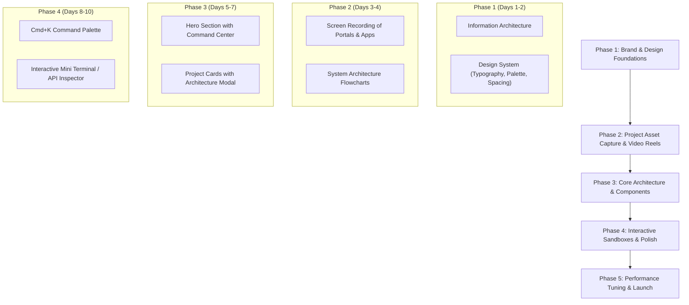

# Developer Portfolio Architectural Blueprint & Implementation Plan
**Candidate:** Samad Kausar — Frontend-Heavy Full Stack Engineer & Product Builder  
**Goal:** Create a portfolio that immediately signals elite engineering craftsmanship, deep product polish, and technical maturity before a visitor even clicks into a project.

---

## 1. Core Philosophy: The "Instant Respect" Principle

Most developer portfolios fail because they look like standard generic templates: cards with a stock screenshot, a list of pill badges (`React`, `Node`), and two dead buttons: *"Demo"* and *"GitHub"*.

When hiring managers, founders, or senior engineering leads land on your site, they evaluate you on **four subconscious criteria within the first 10 seconds**:

1. **Taste & Visual Hierarchy:** Does this person care about typography, spacing, motion curves, and layout precision? (Indicates frontend mastery).
2. **Performance & Snappiness:** Does the site render instantaneously with zero layout shift (CLS = 0), fluid 60fps animations, and zero lag? (Indicates performance engineering).
3. **Engineering Depth:** Is there evidence of distributed systems, real-time protocols, streaming, and architecture, or just CRUD wrappers?
4. **Honesty & Transparency:** Does the candidate clearly explain their exact role, architectural trade-offs, and decisions, rather than claiming they built an entire venture alone?

```
┌────────────────────────────────────────────────────────────────────────┐
│                        VISITOR PERCEPTION FUNNEL                       │
├────────────────────────────────────────────────────────────────────────┤
│ 0 - 3s   │ Hero Impact: Bespoke theme, zero lag, subtle ambient motion │
│ 3 - 10s  │ Interactive Craft: Cmd+K palette, sound/theme toggles, HUD  │
│ 10 - 30s │ System Architecture: Live interactive diagrams, real metrics│
│ 30s+     │ Deep Dive: Immersive video previews & interactive sandboxes │
└────────────────────────────────────────────────────────────────────────┘
```

---

## 2. Solving the "Live vs. Not Live vs. Mobile vs. Repo" Problem

A major hurdle in showcasing real-world software is that **not everything has an open public URL**:
- Some are **enterprise B2B systems** behind client auth (Nestys Admin, Servotech HRMS/ATS).
- Some are **native mobile applications** (Scrollr / LinkPlay, WoKataa).
- Some are **pure backend APIs / Microservices** without a consumer frontend (LinkPlay Fastify streaming API).
- Some are **client websites** (Earth Air Condition).
- Some are **hobby repositories** (UrbanArena).

### The Solution: The "Proof-of-Work" Presentation Framework

Never present every project in the exact same card format. Categorize and present them using **four distinct display modalities**:

| Project Tier | Projects | Primary Display Modality | What Proves It Works |
| :--- | :--- | :--- | :--- |
| **Enterprise Portals** *(Auth Gated)* | Nestys (Seller Central, Eureka, Super Admin), Servotech Suite | **Interactive Video Walkthrough + High-Res Zoomable Mockups + System Diagrams** | Screen captures of real workflows (e.g. bulk uploads, reel moderation) with architecture callouts. |
| **Native Mobile Apps** *(APK/TestFlight or Device)* | Scrollr (LinkPlay), WoKataa (Mobile) | **Interactive Smartphone Frame (Interactive Mockup / Frame-by-Frame Video Player)** | A CSS/Canvas phone mockup running an autoplay-on-hover video reel showing gesture-swiping, tokens, and player mechanics. |
| **Backend & Real-Time APIs** *(Headless/Microservices)* | WoKataa Backend, LinkPlay Resolver API | **Interactive API Playground / Live Endpoint Inspector** | A mini embedded Postman/Swagger terminal where visitors can trigger a test request or view live Swagger/OpenAPI docs. |
| **Live Client Platforms** *(Public Production)* | Earth Air Condition, Stack-IT | **Live Site Preview with Performance / Core Web Vitals HUD** | Direct link with verified PageSpeed / Lighthouse scores, schema verification, and before/after comparison. |
| **Open Source / Hobby** *(GitHub Repos)* | UrbanArena | **GitHub Architecture Blueprint & Code Tour** | Embedded interactive directory tree, Prisma schema visualizer, and clear technical write-up. |

---

## 3. Signature Features That Make Your Portfolio Speak for Itself

To make visitors think *"This person is in the top 1% of developers"* before clicking projects, embed these signature engineering touches into the site itself:

### A. The "Architecture Visualizer" Mode
- Toggleable tab next to project previews: **[Preview] | [Architecture] | [Metrics]**.
- Selecting **[Architecture]** switches the view to an interactive, interactive node graph or clean Mermaid-style diagram showing how data flows (e.g. *Client App → Nginx Reverse Proxy → NestJS Gateway → Redis/BullMQ Queue → Worker*).
- Clicking any node displays the tech stack and why it was chosen.

### B. Command Palette (`Cmd + K` / `Ctrl + K`)
- Instant keyboard navigation for power users.
- Allows jumping to sections, copying email/phone/GitHub, downloading ATS CV vs. Design CV, or toggling developer inspect mode.

### C. Developer "Inspect Mode" / HUD (Heads-Up Display)
- A small floating pill in the corner: `HUD: 60 FPS | React 19 | 12kB First Load | Clean Architecture`.
- Clicking it opens a bottom sheet showing:
  - Exact bundle size and asset loading timeline.
  - State management inspector (e.g. active Zustand store state).
  - Git commit hash of the live portfolio build.

### D. Reusable Video Reel Engine (Portfolio Dogfooding)
- You engineered **Scrollr (LinkPlay)** with an algorithm-free vertical reel player.
- **Dogfood your own work:** In the mobile showcase section, embed a working web version of your reel player that lets visitors swipe through short 10-second clips of your various apps!

---

## 4. Detailed Project Breakdown & Storytelling Strategy

Each project in your portfolio should follow the **STAR-E (Situation, Task, Architecture, Result, Engineering Highlight)** format:

### 1. Nestys Ecosystem (Enterprise Full-Stack Suite)
- **Tagline:** Multi-Portal E-Commerce & Opportunity Platform with Distributed Microservices.
- **The Story:** Built three distinct high-scale web portals (Seller Central, Eureka recruitment & listings, and Super Admin) communicating with a resilient NestJS microservices backend.
- **Key Artifacts to Show:**
  - Seller Central: Order pipelines, real-time inventory matrix, TipTap rich text publishing.
  - Super Admin: HLS.js adaptive video streaming moderation console for reels.
  - Backend: Prisma ORM, BullMQ queue workers, Redis caching, AWS RDS/ElastiCache.

### 2. Scrollr / LinkPlay (Mobile & Media Streaming Engine)
- **Tagline:** Android-First Cinematic Mobile Video Reel Player & Fastify Media Streaming API.
- **The Story:** Reimagining vertical short-form video as an editorial, private, algorithm-free experience.
- **Key Artifacts to Show:**
  - Mobile: Expo SDK 54, React Native 0.81, custom Fisher-Yates memory shuffle engine, 60fps virtualized gallery handling 2,500+ items.
  - Backend API: Fastify, yt-dlp, HTTP byte-range proxy streaming (`/api/v1/stream`), two-tier caching, rate limiting, and SSRF defense.

### 3. WoKataa / Kite Clash (Real-Time Gaming Ecosystem)
- **Tagline:** Real-Time Multiplayer Mobile Game with WebSocket & Ably Pub/Sub Architecture.
- **The Story:** Low-latency state synchronization for competitive token-swiping matches.
- **Key Artifacts to Show:**
  - Mobile: React Native 0.74 with Kotlin entrypoints, Reanimated 3 swipeable token deck, dynamic perspective scoreboards.
  - Backend: Hybrid Express + Socket.IO + Ably Cloud architecture, BullMQ background queues for streaks and leaderboard calculations.

### 4. Earth Air Condition (Commercial HVAC Infrastructure)
- **Tagline:** High-Performance Commercial HVAC Platform with Zero-Downtime CI/CD & MCP AI Engine.
- **The Story:** Replaced bloated visual page builders with a lightweight custom theme, custom admin management dashboard, and automated DevOps.
- **Key Artifacts to Show:**
  - Performance: 95+ Core Web Vitals score.
  - DevOps: GitHub Actions FTPS automated deployment pipeline.
  - Innovation: Model Context Protocol (MCP) PKCE OAuth2 bridge for AI assistant content management.

### 5. Servotech Enterprise Suite (W3villa Technologies)
- **Tagline:** Mission-Critical Internal Tooling (PM Board, HRMS, Asset Management, ATS).
- **The Story:** High-throughput internal enterprise dashboards built for daily operational scale.

---

## 5. Recommended Modern Tech Stack

To ensure the portfolio itself serves as undeniable proof of frontend mastery:

| Layer | Recommended Choice | Rationale |
| :--- | :--- | :--- |
| **Framework** | **Next.js 15 (App Router)** or **Vite + React 19** | Server components for instant zero-JS static paint; client islands for rich interactivity. |
| **Styling** | **Tailwind CSS v4** | Clean, maintainable design tokens matching the sleek "Midnight Film Club" / dark luxury vibe. |
| **Animations** | **Framer Motion / Motion** | Smooth page transitions, layout morphing (layoutId for modals), gesture handling. |
| **UI Primitives** | **Radix UI / Shadcn UI** | Unstyled, accessible accessible foundation with full keyboard and screen reader support. |
| **Icons & Media** | **Lucide Icons + Cloudinary / Mux** | Crisp SVG typography and optimized streaming video clips (WebM/MP4). |
| **Hosting** | **Vercel / Cloudflare Pages** | Global edge CDN, sub-50ms TTFB worldwide, automatic CI/CD. |

---

## 6. Execution Roadmap & Milestones



### Phase 1: Brand & Layout Blueprint
- Define design tokens: Dark luxury celluloid palette (`#0B0B0A` background, `#F3F3EE` text, `#FF5533` brand accent).
- Create typography hierarchy with a high-end monospace accent (e.g. JetBrains Mono or Geist Mono).

### Phase 2: Media Asset Gathering
- Record 15-to-30 second clean, silent high-frame-rate screen recordings of:
  - Nestys Seller Central (adding product, inventory filter).
  - Nestys Super Admin (reels moderation).
  - Scrollr (Framer swipe feed, in-tab video play).
  - WoKataa (live game swipe deck).
  - Earth Air Condition (live site scroll + Command Center).
- Convert all clips to lightweight loopable WebM/MP4 files (< 2MB each).

### Phase 3: Core Building & Interactive Modals
- Scaffold project repository.
- Implement responsive layout with dual-mode view (Compact Grid vs. Expanded Case Study).
- Implement interactive modal with **Overview**, **Architecture Diagram**, **Tech Choices**, and **Live Code Snippet**.

### Phase 4: Polish & "Flex" Features
- Add `Cmd + K` command bar.
- Add one-click "Copy Resume Summary" or "Download Tailored PDF".
- Add Lighthouse CI to guarantee 100/100 scores across Performance, Accessibility, Best Practices, and SEO.
